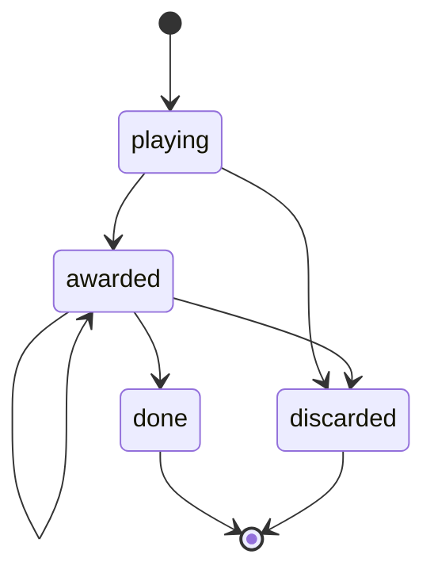
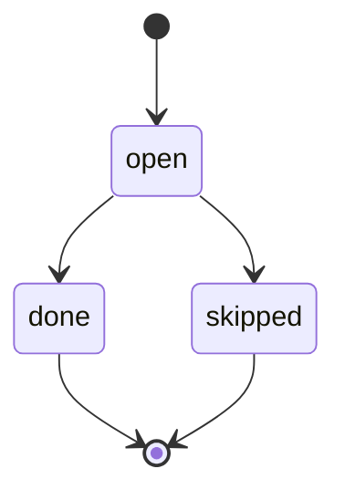
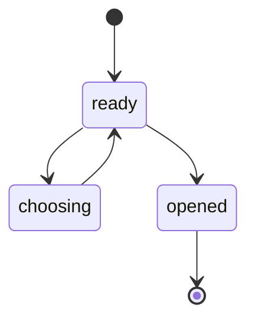
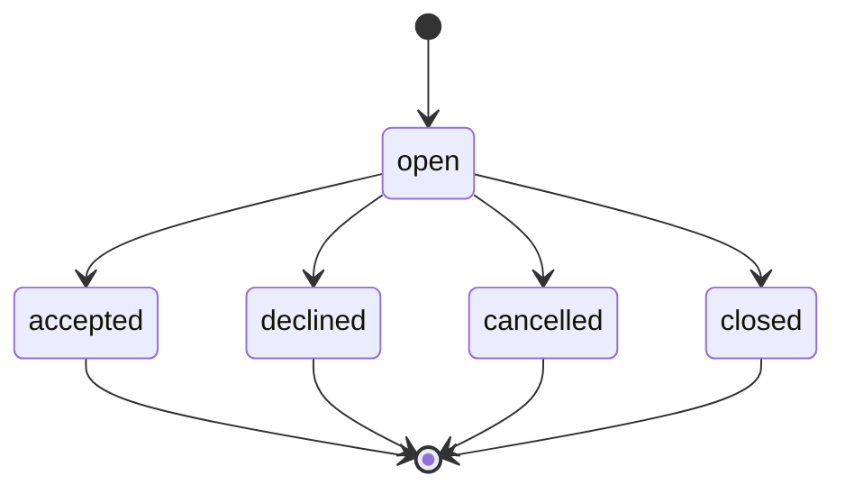
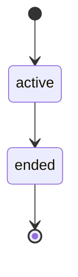
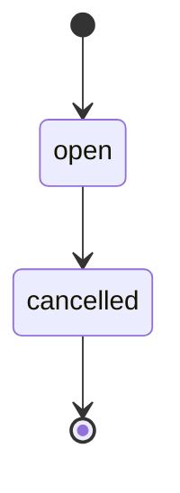
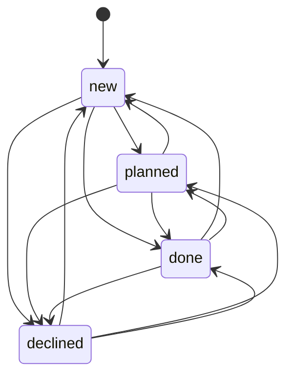
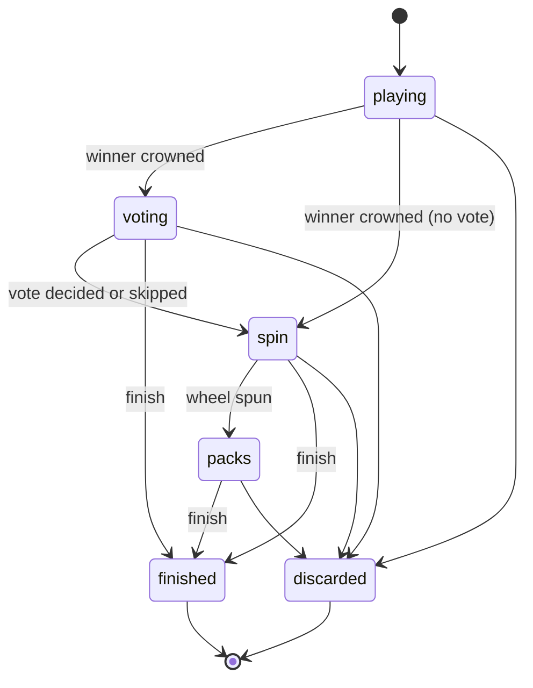

# State machines

<!-- Generated from server/lifecycle.js by `npm run states`. Do not edit by hand: a test checks it matches. -->

Every status in Pre-Con Commander and the moves allowed between them. Code changes a status only through
`move()` in `server/lifecycle.js`; any other move is refused with a 409 (`code: 'illegal_transition'`).

## pod

One game of 3-4 league players. Stored in pods.status.

| State | Meaning |
| --- | --- |
| `playing` | The game is on. Any pod player can crown the winner. |
| `awarded` | A winner is crowned: packs are awarded, then the bonus vote, the spin and opening packs. |
| `done` | Finished and in History. Packs not yet opened can still be opened. |
| `discarded` | Thrown away: not in History, standings or pools. |

## vote

A pod's bonus-pack vote. Opens when the winner is crowned. Stored in pod.vote.status.

| State | Meaning |
| --- | --- |
| `open` | Pod players vote (never for themselves). A tie starts a re-vote between the tied players (the round goes up). |
| `done` | Decided: the winner of the vote gets the bonus pack(s). |
| `skipped` | No vote: the league turned it off, or an admin skipped a stuck one. |

## pack

One booster a player was given. Stored in pod_packs.status.

| State | Meaning |
| --- | --- |
| `ready` | Unopened, with a set. |
| `choosing` | Waiting for its owner to pick a set (after a sacrifice, or an admin "their choice" pack). |
| `opened` | Opened: its cards are in the pool. |

## trade

A thread of offers between two league members. Stored in trades.status, with turn_id = whose answer it waits on.

| State | Meaning |
| --- | --- |
| `open` | Waiting on turn_id to accept, decline or counter (a counter keeps it open and passes the turn). |
| `accepted` | Went through: the cards moved. |
| `declined` | Turned down by the player it waited on. |
| `cancelled` | Withdrawn by whoever sent the last offer. |
| `closed` | Closed by the site: the league ended, a player left, or another trade took one of its cards. |

## league

A season. Stored in leagues.status. Deleting one removes it entirely.

| State | Meaning |
| --- | --- |
| `active` | Pods, packs, trades and game nights happen here. A player is in at most one active league. |
| `ended` | A read-only archive: standings, history and pools stay. |

## night

A proposed game night. Stored in game_nights.status. It counts as over 12 hours after it starts (worked out from the time, not stored).

| State | Meaning |
| --- | --- |
| `open` | Players answer Yes / Maybe / No. Up to 3 open per league. |
| `cancelled` | Called off by whoever proposed it, the league admin or the site admin. |

## feedback

A suggestion or bug report. Stored in feedback.status. The admin can set any status.

| State | Meaning |
| --- | --- |
| `new` | Not looked at yet. |
| `planned` | Going to happen. |
| `done` | Built or fixed. |
| `declined` | Won't happen. |

## A pod's phase

Not stored: `podPhase(pod)` works it out from the pod's status, vote, spin and packs. Every pod the API returns carries it as `phase` (`{ phase, waitingOn, actions }`), and the Discord pings use the same `waitingOn`.

| Phase | Meaning |
| --- | --- |
| `playing` | The game is on; crown the winner when it ends. |
| `voting` | The winner is crowned; pod players vote for who gets the bonus pack. |
| `spin` | Waiting for the winner to spin the wheel (everyone watches). |
| `packs` | The wheel is spun; players open (or sacrifice) their packs. Finish the pod to save it to History. |
| `finished` | In History. Any packs still unopened can be opened. |
| `discarded` | Thrown away. |
